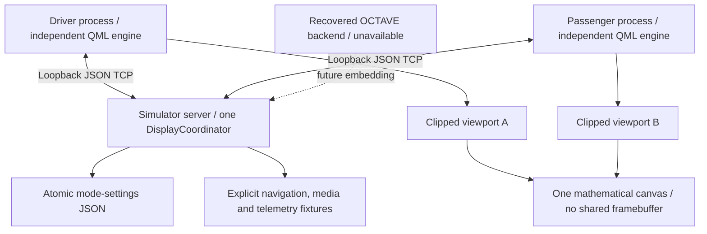

# MacanOS v0.6 — engineering and hardware report

New desktop multi-display integration module. Source baseline: documentation-only commit cefde60. Original v0.5 application unavailable. No publication or merge.


---

# MacanOS v0.6 validation

Date: 2026-11-05. Platform: Debian 13 x86_64, GCC 14.2, CMake 4.4.4, Ninja 1.13.2, Qt 6.8.2. GUI rendering used `QT_QPA_PLATFORM=offscreen` and the Qt Quick software backend. These are executable desktop simulator results, not original v0.5 or vehicle results.

## Actual final results

| Check | Executed result |
|---|---|
| CMake configure and C++17 build | Passed; client, server, coordinator library and two QtTest targets built. |
| Coordinator QtTest suite | 12 test methods passed; 14 reported passes including initialization/cleanup; no failures/skips. |
| QML layout QtTest suite | Six role/resolution cases passed; eight reported passes including initialization/cleanup. Actual mouse clicks selected apps; all visible action targets were at least 44 DIP and inside the window; primary panel width was checked. |
| Multi-process Python suite | 12 tests passed in 44.196 seconds; actual server and frontend executables, no mock frontend. |
| Python compilation and shell syntax | Passed for supplied Python scripts/tests and `scripts/check.sh`. |
| Screenshots | Ten actual Qt `grabWindow()` captures, including both roles for all three modes, unified media, and two additional passenger resolutions. |
| Existing v0.5 tests | **Blocked:** source, test suite and recorded commit absent from the supplied repository. No regression success claimed. |
| Android, ARM64 or physical hardware tests | **Not executed:** no Android toolchain/device or ARM64 target, physical head unit, two outputs or touch controllers. |

There are **30 final test cases excluding Qt initialization/cleanup**: 12 coordinator + six layout cases + 12 process cases. The raw logs and machine-readable summary are in `docs/test-results/`.

Coordinator coverage includes all directed mode transitions, mode persistence, explicit resume after loss, expiry, output availability, role ownership, distinct output requirements, mixed dimensions/scales, bezel offsets, calibrated touch, transition-generation rejection, renderer limits, scheduled transitions, corrupt/unwritable settings, geometry-change fallback and shared-focus persistence.

Process coverage includes all six directed transitions with unchanged backend PID/session, independent app state, shared focus, synchronized media and driver-approved destinations, output-presence simulation, passenger process termination, driver-process shutdown, survivor operation, reconnect, backend silence/restart, retained mode settings, prohibited commands, duplicate-role rejection, timing estimates, 1920×720 and 1920×1080 passenger viewports, touch-coordinate protocol and offline initial startup. Recovered displays require explicit resume after a live session loss. Backend restart instead reloads saved settings when both clients register.

Clock evidence records each client's measured half-RTT uncertainty and the same transition schedule/session. It is not a frame-lock or real-panel latency measurement. State files are sampled independently; their timestamps need not be identical. Screenshots are sequential captures, not proof of simultaneous physical refresh.

## Failures found and fixed

The initial real-process run passed seven of nine tests and failed two: tests observed command-file consumption before the backend's response and state propagation. The client now records acknowledged command results and the harness waits for them. Successful heartbeat replies no longer erase visible operation errors. Both failures passed in subsequent runs; the initial failure log is retained as `initial-failures-resolved.log`.

Visual inspection also found a collapsed navigation panel caused by layout minimum sizing. Explicit side-column constraints fixed it. Qt layout tests now assert that the primary panel stays usable and that touch targets remain visible, bounded and at least 44 DIP across the six tested role/resolution combinations.

Other hardening includes duplicate-owner rejection, stale-generation touch rejection, affine pixel-centre mapping at rotated display edges, explicit resume after geometry changes, bounded JSON frames/output queues and peer count, cleanup of signal connections at server exit, and local ownership validation before backend actions.

The development host initially lacked CMake/Ninja and Qt headers. CMake/Ninja were installed into a workspace prefix; matching Debian Qt development packages were downloaded/extracted into another workspace prefix, using the installed matching runtime. Initial configure failures for missing runtime/OpenGL links were corrected in that local prefix. Nothing was installed into the host's system directories.

Final configuration emitted optional XKB and QML static-plugin link-target warnings due to that extracted development prefix. Dynamic QML runtime imports succeeded; all GUI tests and screenshots executed without ReferenceError, TypeError, binding-assignment or engine-load errors. Runtime tests establish successful software rendering only. The standard Debian dependency installation in the README avoids relying on the workspace-specific toolchain paths.

## Limitations and unfinished integration

- `cefde60` contains reconstructed reports only. The missing original v0.5 UI, SQLite trips, map/routing, real audio adapter and read-only diagnostic enforcement have not been modified or tested. This module does not prove preservation of those features.
- Its JSON TCP protocol is local to this module; an adapter to the actual OCTAVE API remains to be implemented against recovered source. There is no WebSocket transport here.
- All route, GPS, trip and vehicle figures are fixtures; the map is an original schematic. Shared destination approval is functional simulation, not tested turn-by-turn navigation. Media playback synchronizes state but produces no audible output.
- Mode settings and local app choices persist; fixture navigation/media state resets with backend restart. v0.5 SQLite or media persistence is not implemented by this module.
- Physical Qt screen selection/removal hooks are prepared. Output disappearance was simulated through the presence file; actual connector removal, compositor behavior, hardware DPI and touch routing are unverified.
- Logical canvas clipping duplicates scene rendering in each client. No GPU, thermal, refresh-phase or sustained performance benchmark was executed. There is no guarantee of visually seamless panel color, geometry or timing.
- Simulator sizes are not NaviRider specifications. Android secondary display/presentation/HOME APIs were researched, not executed. No APK or launcher was built.
- Factory Porsche systems, controls, electrical interfaces, security and vehicle modules were not accessed. Backend vehicle commands are absent and unknown operations are denied. Existing v0.5 restrictions must be regression-tested after source restoration.

## Recommended next milestone

Recover the actual v0.5 source checkout or Git bundle, establish a passing baseline, embed one coordinator into its backend and reuse its real navigation/media services. Then test an authorized Android device exposing two independent displays before evaluating any NaviRider purchase. Keep the original vehicle and factory control interfaces outside this work.


---

# Multi-display hardware compatibility report

Research date: 2026-11-05. **No NaviRider unit, Android APK, ARM64 build or physical dual-display installation was tested.** Desktop results apply only to the supplied C++17/Qt 6.8.2 Linux simulator. The repository supplied for this work contains reconstructed v0.5 documentation, not its application source.

## Evidence matrix

| Capability | Evidence category | Result and missing evidence |
|---|---|---|
| Two independent QML processes, one coordinator | Desktop verified | Mode switching, isolated app selection, shared session, kill/restart and backend recovery tested over loopback. |
| Panoramic canvas without one framebuffer | Desktop verified | Separate clipped viewports with logical bezel gap; 1280×480, 1920×720 and 1920×1080 simulator renderings. These are test sizes, not verified panel specifications. |
| Different display sizes / DPI / rotated touch | Desktop verified in simulation | Geometry and affine mapping unit tests. No physical touch controller, EDID, connector hotplug or calibration verified. |
| Physical 12.3-inch dual-screen configuration | User-described candidate | Exact seller SKU, panel dimensions, motherboard, SoC, ABI, Android API, firmware build and refresh rates remain unknown. A marketing picture or “dual screen” description is insufficient. |
| Android sees two accessible displays | Unknown for NaviRider | Need DisplayManager enumeration with IDs, flags, metrics and independent content on each panel. The second panel could use an MCU, private surface or vendor-only app. |
| Third-party APK on each panel | Unknown for NaviRider | Need installation and display-targeted launch evidence for two role clients, followed by kill/recovery and touch-routing tests. |
| Android Presentation | Platform API documented; device unverified | Presentation-compatible displays must be exposed and usable by the app. This does not imply that two head-unit panels are eligible. |
| Secondary activity launch | Platform API documented; device unverified | API 26+ launch display targeting is conditional on system features and launch permissions. Manufacturer policy may prohibit it. |
| Launcher / automatic startup | Platform API documented; device unverified | HOME role is user granted where available; boot, background start and OEM restrictions require testing. No firmware replacement is required in principle, but success is not established. |
| HDMI/USB-C video input, dual external video paths | Unknown | Need pinout and an actual input demonstration. HDMI output is not HDMI input. No external Linux-to-NaviRider video compatibility is assumed. |
| USB touchscreen endpoints and per-display input routing | Unknown | Need USB descriptors, Android input-device/display associations, touch test on each panel and repeat after reboot. |
| Factory PCM / CAN decoder / camera / parking / steering controls | Unknown for exact unit | Need wiring diagrams and a bench/installer demonstration that factory functions remain available. MacanOS adds no factory-control commands. |
| Standard factory audio, MOST or JL Audio DSP integration | Unknown / outside this module | No audible audio was tested in v0.6. The existing bass fault is unresolved and no amplifier remedy is asserted. |
| Clock synchronization across physical panels | Unverified | Shared time scheduling is desktop tested; refresh phase, latency, density, compositor and thermal performance are not. No frame-lock claim. |

No new seller specification has been independently verified. The historical AliExpress short link does not identify a stable, verified hardware revision for this report. Seller-advertised specifications from another SKU must not be carried over as facts.

## Android API findings

[DisplayManager](https://developer.android.com/reference/android/hardware/display/DisplayManager) enumerates logical displays and provides display-change listeners. Enumerate all displays, not just presentation candidates; record IDs, density and flags. A physical panel is not necessarily an app-accessible logical display. Android IDs may change across boot, so roles need a verified stable association rather than hardcoded IDs.

[Presentation](https://developer.android.com/reference/android/app/Presentation) is a dialog on a secondary display, with resources/density derived from that display. It can be cancelled when the display or hosting task disappears; handle dismissal and invalid-display exceptions. Current documentation allows presentation-flagged internal displays starting with Android 16; older versions restrict internal presentation targets. A Presentation shares its hosting application's lifecycle and process, so it is not sufficient by itself for MacanOS frontend crash isolation.

[ActivityOptions.setLaunchDisplayId](https://developer.android.com/reference/android/app/ActivityOptions#setLaunchDisplayId(int)) was added in API 26. It targets permitted displays; the setting is ignored if secondary-display activities are unsupported. Public/owned display rules and launch permissions apply. Check [ActivityManager.isActivityStartAllowedOnDisplay](https://developer.android.com/reference/android/app/ActivityManager#isActivityStartAllowedOnDisplay(android.content.Context,int,android.content.Intent)) where available, and handle denial. Two activities can still share one process; independent failure domains require a tested process arrangement, potentially separate application packages. Separate Qt runtimes in one Android package have not been implemented or validated here.

[RoleManager.ROLE_HOME](https://developer.android.com/reference/android/app/role/RoleManager#ROLE_HOME), available from API 29, supports a user-approved HOME role request where that role is available. A launcher needs appropriate HOME intent handling. This does not grant privileged display access, kiosk/device-owner rights, immunity from background restrictions or control of reverse-camera overlays. Older systems use their default-HOME mechanism. Do not alter vendor firmware, device policy or security protections to force compatibility.

Qt's [Window/screen APIs](https://doc.qt.io/qt-6/qml-qtquick-window.html) describe screen selection, but desktop `QWindow::setScreen()` success is not proof of Android platform-plugin support on this head unit. An Android port needs a matching Qt Android toolchain and an actual test of native window/activity/presentation hosting. No Android SDK, NDK, Qt Android kit, Java compiler or ADB executable is available on this development host; no APK was built.

## Recommended architecture decision

**Buy no head unit on the strength of its “dual-screen” label.** Require a returnable bench sample or seller evidence that two ordinary third-party applications can render independently, receive their own touch input, survive one client stopping and retain factory camera/PCM operation. If only mirroring or a private OEM surface is exposed, all three MacanOS modes cannot be promised on those two panels.

Prefer Android-native deployment only after that test succeeds. Keep one shared backend owner; attach two role clients to it. If an external Linux system is needed, prefer a mature dual-output Linux board and independently documented display/input hardware. Raspberry Pi 5 is a conditional bench candidate, not proof that it can drive NaviRider. A compositor such as Wayland is the more practical starting point for separate frontend processes on two outputs; do not assume two EGLFS processes can concurrently own the same DRM device.

UNIFIED is implemented at the application viewport level, so separate display controllers are acceptable **if** both expose independent render and input paths. Physical continuity still requires measured dimensions, bezel gap, density, color/brightness and latency calibration. SHARED and INDEPENDENT need the same independently addressable display prerequisite; software fallback cannot create a missing output path.

## Exact bench evidence required

1. Seller SKU, motherboard revision, SoC and ABI, real API level and firmware build, panel pixel resolutions/refresh, wiring and recovery documentation.
2. Authorized, read-only Android enumeration: `scripts/probe-android.py --serial DEVICE --output evidence.json`. This tool is prepared but unexecuted; it does not unlock, root, change policy or launch controls. Review raw input/display data before sharing it.
3. Independent role content on each accessible display; HOME selection and reboot behavior; touch on each panel; one client killed without the other stopping; repeated display disconnect/reconnect.
4. Run the three mode transitions, native-density geometry and bezel calibration, sunlight/night tests, and continuous visualization while measuring CPU/GPU, memory and temperature. Verify that the compositor does not mirror or override content.
5. Confirm vendor reverse-camera/parking/factory audio behavior with the manufacturer/installer. Do not attach this simulator to factory control modules. Electrical power and ignition integration need a separate automotive design and shutdown test.

Until these gates pass, the purchase decision remains conditional. The next software milestone is to restore v0.5 source, embed this coordinator there, and test an authorized Android bench device; it is not a vehicle installation milestone.


---

# MacanOS v0.6 display coordinator

This is a new, executable integration module on `macanos/v0.6`, based on the documentation-only repository commit `cefde60`. The supplied repository has two historical commits and no v0.5 application source. It does not contain the recorded v0.5 commit `d6a19ad`. No OCTAVE source, existing UI, audio output, map renderer, database or diagnostics implementation has been replaced or regression-tested. The module must still be integrated when that baseline is recovered.



## Runtime modes

| Mode | App selection and layout | Shared state |
|---|---|---|
| INDEPENDENT | Each process persists its own Navigation/Media selection in a separate INI file. Driver prioritizes speed/status; passenger prioritizes media/journey. | Both subscribe to the same model. Independent layouts do not create device connections. |
| UNIFIED | Each process draws a clipped viewport of a common logical scene. Navigation schematic and procedural media visualization span both screens. Headers and controls remain local. | Scene, route, media, canvas dimensions, transition generation and animation epoch. |
| SHARED | Selecting Navigation or Media changes shared focus; driver and passenger retain role-specific arrangements. | Destination approval, metadata, play/pause, track, volume, shared focus and transitions. |

These Navigation/Media applications are QML modules within each separate client executable. This prototype does not launch arbitrary Android applications. Its schematic route, journey numbers, GPS and speed are explicitly simulated fixtures. Its media playback state is silent; it does not replace v0.5 audio playback or navigation.

## Mode and failure state machine

`requestedMode` is stored atomically in a schema-versioned JSON file. `effectiveMode` reflects actual display availability. Both registered, healthy processes and distinct output IDs are required for coordinated modes. Each role has one TCP-connection owner; another healthy owner cannot take it over.

A disconnected socket triggers immediate fallback to INDEPENDENT on the survivor. Heartbeats run every 250 ms, with backend expiry at 1,800 ms. A client treats a silent server as stale after 1,200 ms and switches locally to INDEPENDENT; after 3,000 ms it reconnects. Reconnection backs off between 100 and 3,000 ms. The last model remains visibly stale and actions are unavailable offline.

After an active coordinated session loses a display, `resumeRequired` latches: the saved preference survives, but reconnecting alone does not cause an unexpected panorama. Explicitly selecting that mode resumes it. At cold backend startup, a saved mode activates when both displays first register. A geometry change during a coordinated session, or a bezel change during UNIFIED, also requires explicit resume. Unsupported geometry or duplicate output identities prevent UNIFIED. Manual INDEPENDENT selection and safety fallback can interrupt a scheduled transition.

The backend does not restart during mode switches. Each frontend owns its own engine/window/event loop. Closing or killing one leaves the other and the backend alive. The launcher intentionally allows a frontend to remain closed; it stops the session when both clients exit. Production supervision must be attached to the recovered v0.5 deployment system.

## Geometry and touch

Native dimensions divided by configured scale give logical DIP. Displays are top aligned, with driver first and passenger at `driverWidthDip + bezelGapDip`. Unequal heights leave an unused logical area rather than stretching content. The bezel is a logical gap, not a verified millimetre measurement. A physical calibration is required before translating bezel dimensions to DIP.

Each client has an independently clipped QML scene translated by its viewport origin. No combined OS desktop, physical framebuffer, video input or shared GPU surface is required. The panorama implementation uses a full logical scene in each process and clipping, so it duplicates rendering work; it is not a GPU-optimized tiled renderer. Canvas limits are 8192 × 2160 DIP. Actual use on two 12.3-inch panels requires GPU and thermal measurements.

Touch profiles contain a normalized 2×3 affine matrix. Native pixel centres are transformed, scaled to local DIP, then offset into the global canvas in UNIFIED. The bezel consumes logical distance but has no input surface. Invalid, outside, unavailable, wrong-owner, stale-generation and mid-transition touches are rejected. `touch-identity.json` and `touch-rotate-180.json` are examples. This is application coordinate mapping, not OS calibration or verified Android touch routing. Panoramic taps exercise coordinate reporting; they do not implement map panning or zoom gestures.

`--screen` binds to a Qt-enumerated physical output and handles Qt screen removal/reappearance. Without it, two desktop windows use explicit simulator output IDs; this does not prove that the host has two physical displays. Presence-file tests simulate output disappearance. Physical connector hotplug and Android display routing have not been tested. Resize changes are re-registered after a 150 ms debounce.

## State and animation synchronization

Every snapshot includes server session UUID, monotonic server time, revision, transition generation, scheduled start, duration, logical geometry and one shared model. The backend schedules transitions 200 ms ahead with a 420 ms fade. Clients use ping midpoint estimates of clock offset and expose measured half-RTT uncertainty. Both QML scenes derive fade progress and visualization phase from this server epoch, rather than starting unrelated animations when a message arrives.

This is coordinated timing, not physical frame lock. The loopback simulator measures low RTT; scheduling jitter, compositor refresh, Android suspension and asymmetric network delay remain limitations. A late snapshot advances directly to the current phase. Input is rejected during transitions to avoid mapping a tap onto a different scene generation.

## Protocol and safety boundary

The simulator uses bounded, newline-delimited JSON over IPv4 loopback. Requests have `id`, `op`, `args`; replies have `id`, `ok`, `result`, `error`. Server events are `{ "event": "state", "value": ... }`. Supported operations are `getState`, `ping`, `register`, `heartbeat`, `setMode`, `setSharedApp`, `setUnifiedScene`, `setBezelGap`, `touch`, and the fixture `model` command whitelist.

This is the new module's protocol, not a verified implementation of the unavailable OCTAVE JSON TCP/WebSocket contract. It is loopback-only, without remote authentication or TLS. Any local process can read state; role ownership prevents accidental duplicate display owners but is not an authentication mechanism. Do not expose the listener to a vehicle network or remote network without designing authentication and transport security.

No vehicle port, OBD session, CAN connection, factory-control API or real audio device is opened. Unsupported commands—including DTC clearing—are rejected by the backend dispatcher, not just hidden in QML. Display mode and fixture media actions cannot create extra OBD sessions. The existing v0.5 read-only enforcement cannot be inspected until its source is restored.

## Integration work still required

1. Restore the actual v0.5 source and build/test it unchanged.
2. Add `displaycoordinator` to the existing backend and own one instance there. Remove the standalone simulator server from production launch; do not create another telemetry owner.
3. Map coordinator registration/heartbeat and state onto the real OCTAVE API using its actual permission model. Preserve existing backend prohibitions and add DTC/write-command regression tests against it.
4. Replace `FixtureModel` with subscriptions to existing navigation, media and telemetry services. Preserve the existing passenger proposal/driver approval contract, trip SQLite storage and audio ownership.
5. Embed the viewport/clock logic in the recovered driver/passenger QML designs. This module's original dark QML screens are test fixtures, not a recovered or redesigned v0.5 interface.
6. Run all existing v0.5 regressions plus the v0.6 suites and physical output/touch tests. Roll back to the untouched restored v0.5 baseline if integration fails.


---

# Installation and operation

Follow the root README build commands. This package includes source and test evidence, not portable prebuilt binaries. Qt development and runtime components must come from compatible installations. Qt 6.7+ is required. Debian 13/Qt 6.8.2 was used here; older distributions may need a separately installed Qt kit and `CMAKE_PREFIX_PATH`.

## Three processes

The convenience launcher uses one server and two separately spawned client executables. For manual launch, run these in separate terminals from the repository root:

```sh
./build/macanos-display-server --port 45670 --settings .runtime/modes.json
./build/macanos-display-client --role driver --port 45670 --settings .runtime/driver.ini
./build/macanos-display-client --role passenger --port 45670 --settings .runtime/passenger.ini
```

The server listens only on IPv4 loopback. There is no remote/LAN transport in this module. No OBD, GNSS, CAN, factory audio or vehicle control device is opened. Do not start this as a replacement for an installed v0.5 backend; it is an isolated simulator.

For configured 1920×720 simulator windows:

```sh
python3 scripts/run-simulator.py --width 1920 --height 720
```

For two physical Qt outputs, after confirming their Qt screen indices:

```sh
python3 scripts/run-simulator.py --driver-screen 0 --passenger-screen 1 --fullscreen
```

Physical output use is prepared, not verified. The current simulator validates 1280×480, 1920×720 and 1920×1080 logical windows. Other aspect ratios and smaller windows may need further layout work. Qt's compositor determines actual window size and output density; a fullscreen resize re-registers the resulting dimensions. Avoid assuming the candidate NaviRider exposes two Qt screens.

A client accepts `--width`, `--height` in native pixels and `--scale` in pixels/DIP. For a 1920×720 configured surface at scale 1.5, the logical viewport is 1280×480. `--touch-profile config/touch-rotate-180.json` loads an affine profile. Match the scale to the verified output configuration. Profiles do not reroute OS input devices or calibrate physical hardware.

## Runtime controls

Both windows have mode and Navigation/Media buttons. Mode changes are scheduled on the shared server clock. Buttons are disabled during incompatible transitions; INDEPENDENT can always interrupt while connected. The read-only server boundary is unchanged by mode selection.

The launcher also exposes optional command files:

```sh
python3 scripts/control.py setMode UNIFIED
python3 scripts/control.py localApp media
python3 scripts/control.py setUnifiedScene navigation
python3 scripts/control.py setBezelGap 30
python3 scripts/control.py --role driver screenshot /tmp/macanos-driver.png
```

A bezel change in active UNIFIED falls back to INDEPENDENT until explicitly resumed. A logical gap is not a millimetre calibration. Desktop UNIFIED has local headers over the shared scene; it intentionally avoids placing essential controls inside the bezel.

To simulate loss of the passenger output while retaining its process:

```sh
python3 -c 'import json,pathlib; pathlib.Path(".runtime/presence.json").write_text(json.dumps({"driver": True, "passenger": False}))'
```

Set `passenger` back to `true` or remove that file to restore it. Select the saved mode explicitly after recovery. Closing one frontend or killing its process exercises a separate failure path. The backend process does not restart during either operation.

## Persistence and recovery

- `modes.json`: schema 1, requested mode, shared app, unified scene and logical bezel gap; written with QSaveFile atomic replacement. Invalid settings start with INDEPENDENT defaults and an error indication.
- `driver.ini` / `passenger.ini`: independent Navigation/Media selections. These are separate local states, even while a coordinated mode is active.
- Diagnostic JSON includes mode, availability, PID, clock uncertainty, last command result and latest backend snapshot. It is simulator instrumentation, not production vehicle logging.
- Fixture route/media/telemetry state resets with the simulator backend. This does not implement or test v0.5 trip/media persistence.

If the backend restarts, clients reconnect and register on its new session UUID. The saved mode becomes active after both register. If one display disappeared during a running coordinated session, returning does not automatically resume it. A live geometry change also requires explicit resume.

No global installation or system service is installed by these scripts. To roll back this local module, stop its processes and check out `cefde60`; keep `.runtime` separately if settings are needed. That rollback returns to documentation only, not the absent working v0.5 application.
