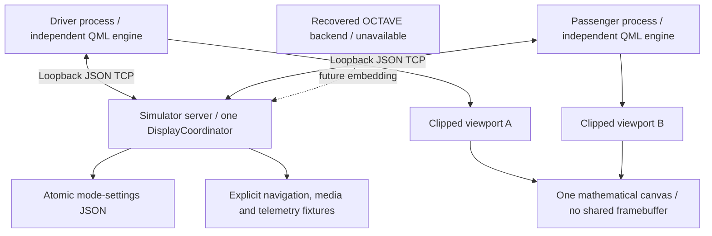

# MacanOS v0.6 display coordinator

This is a new, executable integration module on `macanos/v0.6`, based on the documentation-only repository commit `cefde60`. The supplied repository has two historical commits and no v0.5 application source. It does not contain the recorded v0.5 commit `d6a19ad`. No OCTAVE source, existing UI, audio output, map renderer, database or diagnostics implementation has been replaced or regression-tested. The module must still be integrated when that baseline is recovered.

## Runtime modes

| Mode | App selection and layout | Shared state |
|---|---|---|
| INDEPENDENT | Each process persists its own Navigation/Media selection in a separate INI file. Driver prioritizes speed/status; passenger prioritizes media/journey. | Both subscribe to the same model. Independent layouts do not create device connections. |
| UNIFIED | Each process draws a clipped viewport of a common logical scene. Navigation schematic and procedural media visualization span both screens. Headers and controls remain local. | Scene, route, media, canvas dimensions, transition generation and animation epoch. |
| SHARED | Selecting Navigation or Media changes shared focus; driver and passenger retain role-specific arrangements. | Destination approval, metadata, play/pause, track, volume, shared focus and transitions. |

These Navigation/Media applications are QML modules within each separate client executable. This prototype does not launch arbitrary Android applications. Its schematic route, journey numbers, GPS and speed are explicitly simulated fixtures. Its media playback state is silent; it does not replace v0.5 audio playback or navigation.

## Mode and failure state machine

`requestedMode` is stored atomically in a schema-versioned JSON file. `effectiveMode` reflects actual display availability. Both registered, healthy processes and distinct output IDs are required for coordinated modes. Each role has one TCP-connection owner; another healthy owner cannot take it over.

A disconnected socket triggers immediate fallback to INDEPENDENT on the survivor. Heartbeats run every 250 ms, with backend expiry at 1,800 ms. A client treats a silent server as stale after 1,200 ms and switches locally to INDEPENDENT; after 3,000 ms it reconnects. Reconnection backs off between 100 and 3,000 ms. The last model remains visibly stale and actions are unavailable offline.

After an active coordinated session loses a display, `resumeRequired` latches: the saved preference survives, but reconnecting alone does not cause an unexpected panorama. Explicitly selecting that mode resumes it. At cold backend startup, a saved mode activates when both displays first register. A geometry change during a coordinated session, or a bezel change during UNIFIED, also requires explicit resume. Unsupported geometry or duplicate output identities prevent UNIFIED. Manual INDEPENDENT selection and safety fallback can interrupt a scheduled transition.

The backend does not restart during mode switches. Each frontend owns its own engine/window/event loop. Closing or killing one leaves the other and the backend alive. The launcher intentionally allows a frontend to remain closed; it stops the session when both clients exit. Production supervision must be attached to the recovered v0.5 deployment system.

## Geometry and touch

Native dimensions divided by configured scale give logical DIP. Displays are top aligned, with driver first and passenger at `driverWidthDip + bezelGapDip`. Unequal heights leave an unused logical area rather than stretching content. The bezel is a logical gap, not a verified millimetre measurement. A physical calibration is required before translating bezel dimensions to DIP.

Each client has an independently clipped QML scene translated by its viewport origin. No combined OS desktop, physical framebuffer, video input or shared GPU surface is required. The panorama implementation uses a full logical scene in each process and clipping, so it duplicates rendering work; it is not a GPU-optimized tiled renderer. Canvas limits are 8192 × 2160 DIP. Actual use on two 12.3-inch panels requires GPU and thermal measurements.

Touch profiles contain a normalized 2×3 affine matrix. Native pixel centres are transformed, scaled to local DIP, then offset into the global canvas in UNIFIED. The bezel consumes logical distance but has no input surface. Invalid, outside, unavailable, wrong-owner, stale-generation and mid-transition touches are rejected. `touch-identity.json` and `touch-rotate-180.json` are examples. This is application coordinate mapping, not OS calibration or verified Android touch routing. Panoramic taps exercise coordinate reporting; they do not implement map panning or zoom gestures.

`--screen` binds to a Qt-enumerated physical output and handles Qt screen removal/reappearance. Without it, two desktop windows use explicit simulator output IDs; this does not prove that the host has two physical displays. Presence-file tests simulate output disappearance. Physical connector hotplug and Android display routing have not been tested. Resize changes are re-registered after a 150 ms debounce.

## State and animation synchronization

Every snapshot includes server session UUID, monotonic server time, revision, transition generation, scheduled start, duration, logical geometry and one shared model. The backend schedules transitions 200 ms ahead with a 420 ms fade. Clients use ping midpoint estimates of clock offset and expose measured half-RTT uncertainty. Both QML scenes derive fade progress and visualization phase from this server epoch, rather than starting unrelated animations when a message arrives.

This is coordinated timing, not physical frame lock. The loopback simulator measures low RTT; scheduling jitter, compositor refresh, Android suspension and asymmetric network delay remain limitations. A late snapshot advances directly to the current phase. Input is rejected during transitions to avoid mapping a tap onto a different scene generation.

## Protocol and safety boundary

The simulator uses bounded, newline-delimited JSON over IPv4 loopback. Requests have `id`, `op`, `args`; replies have `id`, `ok`, `result`, `error`. Server events are `{ "event": "state", "value": ... }`. Supported operations are `getState`, `ping`, `register`, `heartbeat`, `setMode`, `setSharedApp`, `setUnifiedScene`, `setBezelGap`, `touch`, and the fixture `model` command whitelist.

This is the new module's protocol, not a verified implementation of the unavailable OCTAVE JSON TCP/WebSocket contract. It is loopback-only, without remote authentication or TLS. Any local process can read state; role ownership prevents accidental duplicate display owners but is not an authentication mechanism. Do not expose the listener to a vehicle network or remote network without designing authentication and transport security.

No vehicle port, OBD session, CAN connection, factory-control API or real audio device is opened. Unsupported commands—including DTC clearing—are rejected by the backend dispatcher, not just hidden in QML. Display mode and fixture media actions cannot create extra OBD sessions. The existing v0.5 read-only enforcement cannot be inspected until its source is restored.

## Integration work still required

1. Restore the actual v0.5 source and build/test it unchanged.
2. Add `displaycoordinator` to the existing backend and own one instance there. Remove the standalone simulator server from production launch; do not create another telemetry owner.
3. Map coordinator registration/heartbeat and state onto the real OCTAVE API using its actual permission model. Preserve existing backend prohibitions and add DTC/write-command regression tests against it.
4. Replace `FixtureModel` with subscriptions to existing navigation, media and telemetry services. Preserve the existing passenger proposal/driver approval contract, trip SQLite storage and audio ownership.
5. Embed the viewport/clock logic in the recovered driver/passenger QML designs. This module's original dark QML screens are test fixtures, not a recovered or redesigned v0.5 interface.
6. Run all existing v0.5 regressions plus the v0.6 suites and physical output/touch tests. Roll back to the untouched restored v0.5 baseline if integration fails.
