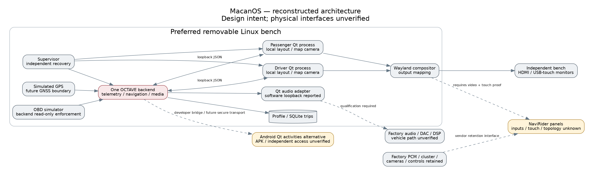

# Read this first

**This is a report reconstruction from the conversation, not recovery of the original software artifacts.** The original development environment is unavailable. The new workspace has no MacanOS repository, binaries, archives, original screenshots or raw test logs. Connected-repository searches found no recoverable project copy. The earlier work was reported as local and unpublished.

This package recreates the engineering reports, compatibility matrix, architecture diagram, estimated bill of materials, risk assessment, bench checklist and installation reference. Software results below are **historical results reported in the preceding conversation**; they have not been rerun or independently verified in this replacement workspace. Only these newly generated document files are being validated now.

The previous record identifies branch `macanos/v0.5`, final commit `d6a19ad`, implementation commit `ea6c7b7` and packaging change `5701ecd`, based on v0.4 commit `a702fec`. These references have not been recovered from a Git repository here.

**Not included:** original source changes, tested AMD64 executable package, ARM64 source/deployment archive, Android prototype source files, actual screenshots or raw validation logs. No substitute executables or invented screenshots are provided.

# 1. Decision and project boundaries

MacanOS is intended for a 2017 Porsche Macan Base, using OCTAVE's C++17, Qt 6/QML, JSON TCP service, media services and SQLite trip history. The design uses two independent frontends with one backend. The driver frontend is an infotainment role, not a replacement for the factory cluster or warnings.

**Recommended decision from the prior report:** defer purchasing the NaviRider-style head unit and JL amplifier. First obtain exact seller evidence, diagnose the existing bass fault, and validate a removable bench system. A Raspberry Pi 5 4GB with active cooling and independently specified HDMI/USB-touch monitors was the preferred bench candidate. This does not establish installed Macan or NaviRider compatibility.

Do not assume two physical screens appear as two Android displays. Do not assume HDMI is an input, USB exposes touchscreen HID, a 64-bit processor exposes a 64-bit application ABI, or factory audio uses MOST. Keep factory controls, safety systems and vehicle-control modules outside scope. No purchase, firmware modification, security bypass, publication or merge is authorized by this reconstruction.

# 2. Deliverable availability

| Deliverable | Recreated package | Original-artifact status |
|---|---|---|
| Engineering report and validation summary | PDF, Word and Markdown | Reconstructed from conversation |
| Compatibility matrix and BOM | Report and CSV | Historical assessment; not newly researched |
| Architecture diagram | Report, SVG and PNG | Newly drawn from recorded design |
| Integration risks and bench checklist | Report | Reconstructed |
| Installation/deployment instructions | Reference commands and limitations | Implementation files unavailable |
| v0.5 source and Android prototype code | Not included | Requires repository/workspace recovery |
| Tested AMD64 application archive | Not included | Original archive unavailable |
| ARM64 source/deployment archive | Not included | Original archive unavailable; no successful full ARM64 build reported |
| Actual screenshots and raw test logs | Not included | Original files unavailable |

# 3. Hardware evidence and compatibility matrix

The reference product was `https://a.aliexpress.com/_mPtr5ML`. The previous investigation could not retrieve that exact listing. Its item, selected variant and specifications remain unresolved. This reconstruction does not claim a fresh listing fetch.

Classification: **Verified** means measured on the exact hardware; **seller-advertised** is a claim scoped to a named product; **inferred** is an engineering hypothesis; **unknown** means evidence is missing. There were zero verified hardware specifications for the exact referenced NaviRider unit.

Comparable seller pages previously discussed included KOASON early-Macan dual-screen models, R_PROJEKT's MediaTek 8667/Android 13 listing, iKAGOO FD-136's unspecified Qualcomm eight-core/Android 16 listing, and a Navifly early-Macan product. These differing claims must not be transferred to NaviRider or treated as one shared motherboard.

| Specification | Exact NaviRider status | Required evidence |
|---|---|---|
| SKU, PCM and trim fit | Unknown | Item/variant ID, PCM part/software, dash photos and steering-side configuration |
| Processor and motherboard | Unknown | SoC marking, PCB revision, board identifier and supported Android ABIs |
| Android and firmware | Unknown | SDK level, release, security patch, fingerprint and update policy |
| RAM and storage | Unknown | Ordered configuration, usable capacity and partitions |
| Independent display access | Unknown | OS display dump and different third-party apps simultaneously on separate IDs |
| Shared framebuffer/mirroring | Inferred possibility only | Panel/controller diagram and compositor behavior |
| Resolution and brightness | Unknown | Per-panel modes, refresh, luminance and dimming |
| HDMI input | Unknown | Connector marked IN, accepted modes, latency and two-input demonstration |
| HDMI output | Unknown | Direction, modes and independent versus mirrored behavior |
| External USB touch | Unknown | External-host USB descriptors, separate HID devices/endpoints and mapping proof |
| Bootloader/recovery | Unknown | Supported signed image, checksum and ordinary recovery procedure |
| Third-party APK support | Unknown | Signed Qt APK installation, ABI/API, networking/maps and restart tests |
| Custom launcher/fullscreen | Unknown | HOME selection/reversion, sleep/wake and OEM takeover tests |
| CANBUS decoder | Unknown | Part/firmware, wiring, write behavior and available read-only app interface |
| Factory PCM retention | Unknown | Exact PCM match and failback with MacanOS disconnected/crashed |
| Camera/parking sensors | Unknown | Camera format, switching, overlays/chimes and failure-mode operation |
| Steering/microphone | Unknown | App-accessible key events and microphone/audio routing |
| Factory audio/MOST | Unknown | Vehicle topology, harness, levels, protocol and source priority |
| Ignition/sleep/thermal | Unknown | Cold boot, crank, hot-soak and off-state drain measurements |

An HDMI output cannot receive an SBC's output. Internal touch wiring does not prove external USB HID support. Factory-system retention does not prove third-party app access to its controls. A vendor CAN box may transmit even while MacanOS's own diagnostics are read-only.

# 4. Candidate architecture

The following are previously discussed manufacturer capabilities and judgments, not MacanOS measurements on these boards.

| Criterion | Raspberry Pi 5 | Orange Pi 5 Plus | Radxa ROCK 5B |
|---|---|---|---|
| CPU/GPU family | BCM2712, four A76 cores; VideoCore VII | RK3588 A76/A55; Mali-G610 | RK3588 A76/A55; Mali-G610 |
| Displays | Two micro-HDMI outputs; documented dual 4K60 | Two HDMI outputs; separate input and other interfaces | Two HDMI outputs plus DP/DSI; separate input, revision-dependent |
| Qt 6 route | Debian 13/Trixie and Qt 6.8 bench candidate | Image/kernel/graphics qualification needed | Image/kernel/graphics qualification needed |
| Video | HEVC capability documented; Qt path needs measurement | SoC codec claims do not prove Qt acceleration | Same qualification applies |
| Boot/graphics performance | Unmeasured on target | Unmeasured on target | Unmeasured on target |
| Power/thermal | Suitable bench PSU and active cooler; automotive protection required | Exact supply/draw/cooling need validation | Exact supply/draw/cooling need validation |
| Touch | Compatible independent monitor interface required | Same | Same |
| Prior board budget, USD | 4GB $110–140; 8GB $175–210 | 8GB $120–200 allowance | 8GB $140–220 allowance |

These are historical planning ranges, not current quotes. Use a multi-client Wayland compositor for two independent Qt applications. Two separate EGLFS applications cannot be assumed to own the same graphics device. An SBC having two outputs does not establish that the head unit accepts either.

The preferred Linux bench design has one backend owning telemetry sources, storage and audio. Each frontend owns its layout and map camera. Physical GNSS, OBD, audio, touch and power adapters are separately qualified boundaries.

{width=6in}

# 5. Android-native deployment assessment

The prior v0.5 work was reported to prepare a Qt frontend APK structure, not replace manufacturer firmware or port the entire backend to Android. It reused the QML interface and reconnecting backend client.

The recorded design used separate driver/passenger QtActivity processes, a setup activity enumerating actual Android DisplayManager IDs and explicit display launch requests. Firmware can deny requests or expose only one display. Independent touch, input focus, process survival and OEM camera/PCM takeover still require device tests.

The prototype declared a user-selectable HOME entry and normal immersive fullscreen behavior. It did not force a default launcher, install a privileged boot receiver, unlock a bootloader or override factory functions. HOME selection does not guarantee boot/wake restoration or manufacturer-service retention.

The connection prototype used loopback or an already-authorized ADB reverse developer bridge. Production paired/encrypted network transport was unfinished. Do not expose a trusted local backend to a vehicle/public LAN as a workaround. Audio remained on the backend; Android media controls did not prove Android or factory audio playback.

**Historical blocker:** no successful APK build, Java/NDK compile, emulator run or head-unit run was reported. A target Qt Android ARM64 kit, configured matching host tools, SDK/build tools and compatible NDK were missing. Desktop Qt and Java alone were insufficient.

# 6. Linux deployment engineering reference

The prior implementation was reported to add an independently supervised simulator kiosk while preserving the desktop launcher. The supervisor owned one backend, restarted children with bounded backoff, refused conflicting listeners, emitted JSON logs and retained a persistent profile.

Display assignments used observed Qt names or unique serial selectors. Missing/ambiguous displays hid their windows instead of covering another role. Simulated file-backed hotplug was tested; physical cables/controllers were not.

Release tools were reported to check ELF architecture/checksums, reject unsafe archive members, stage versioned releases, switch symlinks atomically and support rollback while stopped. SQLite backup used its backup API. Code rollback was not a database-schema downgrade mechanism.

A systemd user-service template was prepared but not enabled or boot-tested in a suitable graphical session. Qt clients handled termination on their event loop. Simulated ignition-off stopped applications; it did not halt the host, remove power or send vehicle-control commands. Physical ignition isolation, protected supply and hold-up remained unimplemented.

Offline mode was reported to enforce map/search/routing restrictions at the backend and suppress update checks. Licensed offline packs and a matching cached route could still be used; no regional map/routing database was bundled.

## Commands for a restored repository only

These are references to previously reported files. **They cannot run from this report-only package.** Restore the original repository first.

```sh
python3 macanos/scripts/run.py
python3 macanos/scripts/supervise.py --config macanos/config/desktop-kiosk.json
./build-macanos/macanos-client --list-screens
python3 macanos/scripts/android_build.py --check
sh macanos/deploy/linux/build-native.sh /path/to/build-arm64
```

The prior native build script rejected an AMD64 host. Cross-build attempts did not complete a full target compile/run: repository issues, an installer OOM and a controlled retry cancellation for disk headroom were recorded. A source kit must not be described as a tested ARM64 executable package.

# 7. Bench bill of materials

These prior USD allowances exclude tax, shipping and labor. They are neither current quotes nor purchase authorization. Reuse the development computer and existing monitors first.

| Item | Qty | Prior allowance | Gate |
|---|---:|---:|---|
| Raspberry Pi 5 4GB | 1 | $110–140 | Conditional removable-bench candidate |
| Cooler and ventilated case | 1 | $20–40 | Sustained thermal testing |
| Appropriate bench PSU | 1 | $15–25 | Bench only, not automotive converter |
| Endurance microSD | 1 | $20–35 | Initial boot/recovery |
| micro-HDMI cables | 2 | $15–30 total | Actual monitor inputs |
| Independent HDMI/USB-touch monitors | 2 | $240–500 total | Explicit input/HID specifications |
| USB Audio Class DAC | 1 | $30–100 | Enumeration, level and noise tests |
| Optional NVMe adapter/SSD | 1 | $60–120 | Defer pending measurements |
| Later USB GNSS/antenna | 1 | $30–80 | Interface selection first |
| Later qualified diagnostic adapter | 1 | $50–150 | Read-only qualification |

Core compute/cooling/PSU/storage/cables: approximately **$180–270**. With new touch monitors and DAC: approximately **$450–870**. Automotive power, hold-up, mounting, harnesses and installation need a separate design/quote. The head unit and JL amplifier remain outside an approved purchase list.

# 8. Factory audio and integration risks

The user reported standard factory audio and unresolved loss of bass. That does not identify the amplifier, speaker count, PCM output topology or MOST use. Obtain actual part numbers, options, connector information and wiring documentation before selecting an interface.

The prior report cited JL documentation describing analog and stereo Toslink S/PDIF inputs on the VX800/8i, with USB for configuration/tuning. Do not assume its USB port is a USB Audio Class input. A qualified DAC or digital interface could supply appropriate audio only after rates, level control, grounding, source priority and call/chime retention are verified. MOST and Toslink S/PDIF are different protocols.

An amplifier does not necessarily correct upstream filtering, polarity cancellation, a disconnected/damaged speaker or faulty wiring. Diagnose the existing system first. Use qualified installation measurements and vehicle-specific documentation; do not code control modules to make an unverified harness work.

| Risk | Acceptance evidence |
|---|---|
| Wrong PCM/trim/harness | Exact match; no forced connectors or unverified wiring changes |
| Airbag/vent/trim conflict | Drawings and professional clearance assessment |
| Proprietary CAN-box transmission | Document behavior; MacanOS cannot constrain third-party firmware |
| Camera/PDC/chime priority | OEM takeover with MacanOS closed, crashed and disconnected |
| Sleep drain/crank/heat | Protected supply and measured transitions/current/thermal behavior |
| Firmware/recovery failure | Supported stock image, checksum, recovery and return terms |
| Clipping/noise/missing bass | Trace bandwidth, levels, polarity and output/load behavior |
| Remote backend exposure | Authenticated/encrypted design before LAN deployment |

# 9. Bench checklist and purchase gates

1. Obtain exact SKU, board/SoC/MCU, Android API/ABI and supported recovery documentation.
2. Prove separate OS displays and independent touch with real third-party Qt content. If using an external host, prove two video inputs and both touch returns.
3. Validate native ARM64 build and graphics stack on a removable bench; inventory actual output/input identities.
4. Test either-client failure, backend recovery, display removal/return, persistence, offline startup and rollback.
5. Measure cold boot, wake, sustained resources, temperatures and storage on the target.
6. Test protected bench power and simulated ignition. App shutdown alone does not remove power.
7. Diagnose the bass fault before qualifying a DAC/analog/digital path with controlled gain and suitable loads.
8. Verify factory camera, PDC, chimes, cluster, controls and mechanical clearance before installation.
9. Choose Android-native only after two-display APK proof; choose external Linux/head-unit display use only after input/touch proof. Otherwise use independently specified monitors or decline the unit.

# 10. Historical validation — not rerun here

The preceding conversation reported these results in the original Debian 13 AMD64 workspace, Qt 6.8.2 and GCC 14.2. Original logs/software are unavailable here.

| Check | Previously reported result |
|---|---|
| Upstream CTest | 58/59 passed; existing optional Quick 3D software-renderer failure remained |
| MacanOS Qt suites | 4/4 passed, including 96 layout cases, touch, stale ETA, reconnect and hardware contracts |
| Deployment unit tests | 8/8 passed |
| Navigation/media integration | Passed with real backend and independent clients |
| Kiosk lifecycle | Passed simulated hotplug, independent restart, backend recovery and persistence |
| Staged AMD64 package | Lifecycle passed; source-bearing package run reported 9.729 seconds |
| TypeScript SDK | 7/7 passed |
| Host audio loopback | 330 Hz, volume response and pause silence through real Qt output and private software sink |
| Android APK | Toolchain-blocked; no successful device/emulator run |
| Full ARM64 build/run | Not achieved |
| Systemd boot integration | Not executed in a suitable user session |
| Physical head-unit/vehicle interfaces | Not tested |

## Previously reported host resource measurements

The historical run used two 1920×720 windows, simulated active route, shared MP3, warmed map caches and software/offscreen rendering. CPU percentages refer to one logical core; RSS includes shared mappings.

| Process | CPU % of one core | Peak RSS MiB | Render interval p95 ms |
|---|---:|---:|---:|
| Backend | 5.37 | 60.54 | — |
| Driver | 18.83 | 80.64 | 2.50 |
| Passenger | 17.24 | 77.21 | 2.07 |

These were approximately 15-second desktop observations, not SBC/Android FPS, power or thermal results. Render signals exclude other work/presentation. Requested benchmark updates made swap counts unsuitable as physical refresh rates.

The prior audio test reported normalized RMS around 0.009500 at volume 40, 0.038001 at volume 80, and zero paused, with a 330 Hz software signal. No speakers, physical DAC or vehicle amplifier was verified.

# 11. Recovering missing original artifacts

A report reconstruction cannot recover local Git objects or executable bytes. To restore the complete original deliverables, recover the earlier workspace or supply a saved repository/archive. Useful inputs include a Git bundle, a checkout including `.git`, or the original source-kit/application archives.

The prior record referenced:

- `macanos/artifacts/macanos-v0.5-amd64.tar.gz`
- `macanos/artifacts/macanos-v0.5-arm64-source-kit.tar.gz`
- `macanos/docs/screenshots/v05/driver.png`
- `macanos/docs/screenshots/v05/passenger.png`
- `macanos/docs/test-results/v05-*`

Do not replace them with fabricated code or illustrations labeled as originals. Once recovered, verify hashes, preserve notices, rerun appropriate checks and export fresh attachments. Publishing or merging is unnecessary.

# 12. References retained from the earlier report

These links are retained for traceability, not newly revalidated research.

- OCTAVE: https://github.com/RobDeGeorge/OCTAVE
- Reference product: https://a.aliexpress.com/_mPtr5ML
- Raspberry Pi 5: https://www.raspberrypi.com/products/raspberry-pi-5/
- Orange Pi 5 Plus: https://www.orangepi.org/html/hardWare/computerAndMicrocontrollers/details/Orange-Pi-5-plus.html
- Radxa ROCK 5B: https://docs.radxa.com/en/rock5/rock5b/getting-started/introduction
- Qt Android: https://doc.qt.io/qt-6.8/android-getting-started.html
- Android displays: https://developer.android.com/reference/android/view/Display
- JL/Garmin VXi: https://www.garmin.com.hk/products/audio/jl-vx800-8i/
- OSM tile policy: https://operations.osmfoundation.org/policies/tiles/
- OSM copyright: https://www.openstreetmap.org/copyright
- OSRM: https://project-osrm.org/docs/v5.24.0/api/
