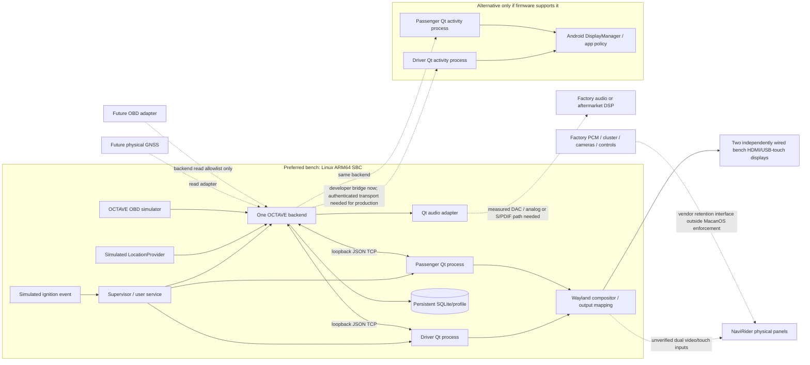

# v0.5 hardware compatibility and purchase decision

Research date: **2026-11-05**. No head unit, SBC, GNSS, OBD adapter, DAC or amplifier
was purchased or connected. This report distinguishes documentary specifications
from measured operation. Desktop simulation does not certify vehicle compatibility.

**Recommendation:** defer the NaviRider and amplifier purchases. Request the exact
SKU evidence below first. For a removable, non-vehicle bench system, prefer a
**Raspberry Pi 5 4GB, Debian 13 / 64-bit Raspberry Pi OS based on Trixie, active
cooling, two independently connected HDMI/USB touch monitors**. This is a bench
architecture recommendation, not a verified installed Macan solution. Existing
monitors can be used initially. The current workload gives no reason to pay the
large premium for 8/16GB before measuring the target.

If the head unit exposes two app-addressable Android displays, two separate Qt
activity processes plus an external backend become a plausible alternative. If it
exposes one wide framebuffer, mirrored panels, or a proprietary passenger video
channel, the current independent-display requirement is not established. If it
has neither usable Android display access nor two external video/touch inputs,
it is unsuitable as a pair of general MacanOS monitors. An SBC's HDMI **output**
and a head unit's HDMI **output** cannot be connected to make an input.

## Evidence register

All external claims below are paraphrased from primary manufacturers or sellers;
no promotional screenshots or proprietary UI assets were copied. Accessed on the
research date unless an older publication date is noted. Listings and prices can
change; request an exact order configuration and return terms.

| ID | Source and what it establishes |
| --- | --- |
| N0 | User's [AliExpress short link](https://a.aliexpress.com/_mPtr5ML). Browser fetch could not open it; workspace HTTPS proxy returned 403 on this host. Exact destination/item number, selected variant and seller specifications could not be retrieved. This is an access limitation, not evidence that the product is unavailable. |
| S1 | [KOASON early-Macan dual screen](https://www.koason.com/products/koason-12-3-inch-dual-android-touch-screen-car-radio-with-dsp-navigation-passenger-entertainment-for-porsche-macan-2014-2017). Seller distinguishes PCM3.1 2014–2016 from PCM4.0 2017; advertises Android app installation, split screen, OEM system switching, rear-camera/steering-control support and an optional optical-audio box. No HDMI direction, touch protocol or Android display topology was established. These are seller claims for KOASON, not NaviRider verification. |
| S2 | [R_PROJEKT Macan dual-screen listing](https://rprojektcar.com/en/collections/pantallas-porsche/products/pantalla-dual-porsche-macan-2014-2024-android-auto-apple-carplay). Advertises MediaTek 8667, Android 13, two 12.3-inch IPS screens, 4/64 or 8/128GB and access to original PCM. No public motherboard revision or display-controller API proof was found. |
| S3 | [iKAGOO FD-136](https://www.ikagoo.com/product/porsche-macan-2014-2017-dual-screen-upgrade/). Seller identifies Qualcomm eight-core without an exact chip, Android 16, dual 12.3-inch layout, 4/64 or 8/256GB and matched harness/CANBUS options; original gauge cluster remains. Seller asks for actual vehicle/configuration details. This conflicts with treating all visually similar units as one chipset/firmware family. |
| S4 | [Navifly early-Macan collection](https://navifly-mall.com/collections/mn-b-porsche) and [product page](https://navifly-mall.com/products/navifly-mnb-mtk8667-8g-256g-12-3-inch-dual-ips-screen-android-car-radio-auto-car-dvd-player-car-play-4g-wifi-bt-for-2014-2017-porsche-macan-pcm4-0). Lists a 2014–2017 dual-screen PCM3.1/4.0 product from **US$1,054**. The URL references MTK8667; a URL slug is not chipset verification. |
| P1 | [Raspberry Pi 5 product](https://www.raspberrypi.com/products/raspberry-pi-5/) and [official product brief](https://pip-assets.raspberrypi.com/categories/892-raspberry-pi-5/documents/RP-008348-DS-4-raspberry-pi-5-product-brief.pdf). Documentary processor, dual-output, codec and power capabilities; no MacanOS board test. |
| O1 | [Orange Pi 5 Plus manufacturer page](https://www.orangepi.org/html/hardWare/computerAndMicrocontrollers/details/Orange-Pi-5-plus.html), [manufacturer wiki](https://www.orangepi.org/orangepiwiki/index.php/Orange_Pi_5_Plus). Indexed manufacturer content identifies RK3588, two HDMI outputs, a separate HDMI input and other display/storage interfaces. Direct revisits timed out; simultaneous modes and software support need target-image validation. |
| R1 | [Radxa ROCK 5B/5B+ documentation](https://docs.radxa.com/en/rock5/rock5b/getting-started/introduction). Documentary RK3588, HDMI/DP/DSI output and separate input capabilities, with model-dependent connectors. This is a comparable alternative, not tested hardware. |
| A1 | [Android Display API](https://developer.android.com/reference/android/view/Display), [ActivityOptions](https://developer.android.com/reference/android/app/ActivityOptions#setLaunchDisplayId(int)), [Presentation](https://developer.android.com/reference/android/app/Presentation). APIs distinguish OS displays, suitable presentation displays and permission/policy failures. Physical panels do not guarantee two accessible IDs or simultaneous independent focus/touch. |
| Q1 | [Qt 6.8 Android prerequisites](https://doc.qt.io/qt-6.8/android-getting-started.html), [platform notes](https://doc.qt.io/qt-6.8/android-platform-notes.html), [Qt manifest template](https://github.com/qt/qtbase/blob/v6.8.2/src/android/templates/AndroidManifest.xml). Qt Android needs a target ABI kit, matching host tools, JDK, SDK/build tools and NDK. Installed desktop Qt alone is insufficient. |
| J1 | [JL/Garmin VXi product specifications](https://www.garmin.com.hk/products/audio/jl-vx800-8i/) and the [manufacturer VX800/8i connection guide, dealer-hosted copy](https://www.customsounds.com/uploads/docs/9e360a7d3e823af08f6eb3a2d81feb04f783d412.pdf). Establishes supported analog/Toslink audio connections and USB's configuration/tuning purpose. No Macan signal compatibility follows. |

## Compatibility matrix: exact referenced NaviRider unit

Labels: **Verified** means observed on that exact hardware; **Seller-advertised**
means a seller claim scoped to the named product; **Inferred** is a conditional
engineering hypothesis; **Unknown** means evidence is missing. There are **zero
verified hardware rows for N0**. Similar housing, screen count or year range does
not establish a shared motherboard. The family evidence column is deliberately
separate from the referenced SKU.

| Item | N0 status | Family evidence / implication | Required proof before purchase |
| --- | --- | --- | --- |
| Exact SKU, 2017 Base/PCM fit | Unknown | S1/S3 advertise early-Macan variants; year labels differ | Item number, selected PCM/trim/LHD/RHD variant; match this car's PCM part/software and dash photos |
| CPU / ARM ABI | Unknown | S2 says MT8667; S3 says unspecified Qualcomm eight-core | Board/chip photos, board revision, CPU identifier and `ro.product.cpu.abilist`; 64-bit CPU does not prove a 64-bit app ABI |
| Motherboard / MCU | Unknown | A vehicle-integration controller is plausible, not identified | Board model/revision, MCU vendor/version and diagram of its responsibilities |
| Android version/API/patch level | Unknown | S2 says 13, S3 says 16; branding may differ from API | `ro.build.version.sdk`, release, security patch and fingerprint; update/support policy |
| RAM/storage | Unknown | Multiple family configurations advertised | Exact ordered memory SKU, usable capacity and firmware partition layout |
| Independent displays | Unknown | “Passenger entertainment” and split-screen marketing do not prove two Android displays | `dumpsys display`, different app content simultaneously, app launch on each OS ID, focus and touch demonstration |
| One wide/mirrored framebuffer | Inferred possibility | Common architecture alternatives; none established for N0 | Block diagram with panel timing/controllers and compositor topology |
| Native resolution / refresh / brightness | Unknown | 12.3 inches is a diagonal, not a resolution | Per-panel pixel mode, EDID/timing where relevant, refresh, luminance, viewing angle and dimming behavior |
| HDMI input | Unknown | No N0 input evidence | Connector photograph marked **IN**, accepted modes, latency, audio handling and simultaneous two-input demonstration |
| HDMI output | Unknown | No N0 output evidence | Connector direction, modes and whether independent or mirrored; output is not useful for accepting SBC video |
| USB touch / external-host access | Unknown | S1 advertises touch/USB, not USB HID export | `lsusb`/USB descriptors from an external host, separate touch devices/endpoints and coordinate mapping for each panel |
| Display-interface electrical type | Unknown | HDMI/DP, LVDS, DSI and proprietary harnesses are not interchangeable | Panel/controller datasheets and documented external interface; do not assume adapters exist |
| APK installation / third-party Qt app | Unknown | S1 advertises Android app installation; S2/S3 describe Android applications | Install our signed test APK, report ABI/SDK, run networking/maps, reboot and retest; Play Store presence alone is insufficient |
| Custom HOME / fullscreen | Unknown | Ordinary Android can offer user-selected HOME and immersive apps; vendor policy may restrict it | Demonstrate selecting/reverting HOME, OEM/camera access, sleep/resume and app restoration |
| ADB / recovery / bootloader | Unknown | Android marketing proves none of these | Authorized debugging policy, signed stock recovery image/checksum, recovery procedure and support terms; no unlock is required by MacanOS |
| CANBUS decoder / protocol | Unknown | S1/S3 advertise matching decoder/harness support | Exact decoder part/firmware, wiring, supported signals, write behavior and whether any read API is exposed to ordinary apps |
| Factory PCM retention | Unknown | S1/S2 advertise original-system switching | Matching PCM version, actual video/audio switching behavior and failback with Android/Linux disconnected |
| Camera / parking sensors | Unknown | S1/S3 advertise retention, scoped to their configurations | Camera electrical/video variant, automatic switch latency, overlay/PDC support, chimes and operation after app failure |
| Steering controls / microphone | Unknown | S1 advertises steering controls | Proven key events accessible to third-party apps versus proprietary OEM app only; microphone/echo routing |
| Factory audio / AUX / MOST | Unknown | S1 offers optional optical box for some premium systems | Actual car topology and harness pinout, signal levels, MOST-generation compatibility if present, chime/call/PCM source priority |
| Thermal / ignition / sleep drain | Unknown | No installed-system measurement | Cold boot, hot soak, crank recovery, current draw asleep, timed shutdown and off-state drain test |

Missing documentation is a purchase blocker, not an invitation to bypass firmware
protections. Request signed images and normal recovery support; do not unlock,
root, reflash or modify a vehicle control module for this prototype.

## SBC comparison and selection

These are manufacturer specifications and engineering judgments, **not measured
MacanOS benchmarks on the boards**. Qt 6 itself is ARM64 capable, but the selected
kernel, Mesa/vendor graphics stack, Qt version and codec integration must be tested
together. Run a Wayland compositor for two independent Qt processes; do not assume
two separate EGLFS/DRM-master applications can own the same graphics device.

| Criterion | Raspberry Pi 5 | Orange Pi 5 Plus | Radxa ROCK 5B (comparable ARM64) |
| --- | --- | --- | --- |
| CPU/GPU (documentary) | 4× A76 up to 2.4GHz; VideoCore VII | RK3588, 4× A76 + 4× A55; Mali-G610 | RK3588; A76/A55 and Mali-G610 |
| Performance judgment | Preferred for integration/documentation; no claim of highest raw speed | More CPU cores/GPU capability on paper; workload/driver result unknown | Similar SoC potential to Orange Pi; BSP result unknown |
| Two display outputs | 2 micro-HDMI, documented dual 4K60 | 2 HDMI outputs; separate HDMI input; additional interfaces | 2 HDMI outputs; DP/DSI; separate input; verify exact board revision |
| Head-unit input compatibility | Unknown | Unknown; having HDMI input on the SBC does not give the head unit one | Unknown |
| Qt 6 Linux | Debian 13/Trixie Qt 6.8 route prepared; validate compositor/GPU on board | Debian/Armbian/vendor-image version and GPU stack need validation | Debian/vendor-image/kernel choices need validation |
| Video decoding | Hardware HEVC documented; H.264/other paths must be measured in Qt | SoC advertises high-resolution codecs; Qt/FFmpeg hardware path not verified | SoC codecs advertised; Qt/FFmpeg path not verified |
| Boot performance | No cold-boot measurement; microSD vs NVMe and services affect it | No measurement; eMMC/NVMe options | No measurement; eMMC/NVMe options |
| Power/thermal | Official 5.1V/5A supply for bench; active cooler recommended; manufacturer reports worst intensive workloads around 12W | Validate exact vendor supply and peak draw with displays/DAC/storage; heatsink/fan needed for sustained testing | Vendor USB-C PD supply range; validate actual draw; cooling needed |
| Touch | External USB HID touch can work if independently exposed; DSI is a different interface | Same USB-HID qualification | Same USB-HID qualification |
| Approximate board budget, USD | 4GB $110–140; 8GB $175–210 planning range | 8GB $120–200 planning allowance, seller quote needed | 8GB $140–220 planning allowance, seller quote needed |
| Automotive readiness | None established; protected supply/ignition/hold-up/thermal installation required for all three | Same | Same |

The Pi budget accounts for official [December 2025 pricing](https://www.raspberrypi.com/news/1gb-raspberry-pi-5-now-available-at-45-and-memory-driven-price-rises/),
[February 2026 increases](https://www.raspberrypi.com/news/more-memory-driven-price-rises/),
[April increases](https://www.raspberrypi.com/news/a-new-3gb-raspberry-pi-4-for-83-75-and-more-memory-driven-price-increases/)
and the [October notice](https://www.raspberrypi.com/news/price-increases-for-2gb-raspberry-pi-4-and-raspberry-pi-5/).
These are planning figures before shipping/tax, not a guaranteed checkout quote.
[Official power discussion](https://www.raspberrypi.com/news/introducing-raspberry-pi-5/)
and [hardware/power documentation](https://www.raspberrypi.com/documentation/computers/raspberry-pi.html)
separate supply rating from actual consumption. MacanOS power and thermal behavior
on every candidate remains unmeasured. NPU specifications offer no current benefit.

## Proposed architecture

Solid edges are the intended local bench/software arrangement; dashed edges require
hardware evidence or future adapters. The “driver” frontend is an infotainment role,
not a replacement for the factory cluster or its warnings.

Android-native client deployment does not currently put the entire OCTAVE backend
on Android. Keeping the backend on Linux preserves upstream integrations and sole
ownership of diagnostics/audio. In v0.5 the Android prototype's connection is local
or an authorized `adb reverse` developer bridge. A secure paired/encrypted production
network client remains necessary; binding the trusted service to a vehicle LAN is
not a substitute. No purchase should depend on the existence of ADB.

## Recommended bill of materials

Phase A is a removable bench, with no car wiring. Price ranges are engineering
allowances in USD as of the research date, excluding tax/shipping/labor. Buy nothing
from this report automatically. Reuse the development computer and existing monitors
until the SBC package is validated natively.

| Item | Qty | Allowance | Decision |
| --- | ---: | ---: | --- |
| Raspberry Pi 5 4GB | 1 | $110–140 | Preferred conditional bench compute; 8GB only if target profiling justifies it |
| Active cooler and ventilated bench case | 1 | $20–40 | Required for meaningful sustained comparison |
| Official-class 5.1V/5A bench PSU | 1 | $15–25 | Bench only; not an automotive converter |
| Endurance microSD, 64–128GB | 1 | $20–35 | Initial reproducible boot/recovery medium |
| micro-HDMI cables | 2 | $15–30 total | Match monitor input; no head-unit compatibility implied |
| USB HID touchscreen monitors | 2 | $240–500 total | Prefer returnable panels with explicit independent HDMI input + USB HID data; not necessarily 12.3-inch |
| USB Audio Class DAC / line output | 1 | $30–100 | After host-audio prototype; measure level/noise and enumeration |
| Optional NVMe adapter + SSD | 1 | $60–120 | Defer until boot/logging I/O measurements show a need |
| Later USB GNSS / antenna | 1 | $30–80 | Select after provider/interface decision |
| Later proven read-only diagnostic adapter | 1 | $50–150 | No car connection in v0.5 |

Core compute/cooling/PSU/storage/cables: **$180–270**. With new touch monitors and
DAC: **$450–870**. Optional storage/GNSS/OBD are additional. Automotive protected
supply, hold-up/power controller, mounting and integration harnesses need a
qualified installation design and supplier quote; reserve roughly $150–400 for
power/harness prototyping, excluding labor and audio equipment. This is not an
approved wiring BOM. Head unit and JL amplifier are deliberately excluded from
approved purchases; S4's $1,054 is only one comparable seller's advertised start.

## Factory-system and audio risk assessment

| Risk | Consequence / evidence gap | Boundary and acceptance evidence |
| --- | --- | --- |
| Wrong PCM/trim/harness | Lost factory display/audio or damaged connection | Identify head-unit part/version, actual harness and vehicle option list; no cutting/coding to make an unverified harness fit |
| Airbag/vent/trim clearance | Passenger screen or bracket may conflict with safety equipment | Supplier mechanical drawings and professional fit assessment; retain cluster and all safety systems |
| Proprietary CAN box | May transmit even while MacanOS is read-only | Keep disconnected during bench work. MacanOS allowlist governs its own transport only, not seller firmware or another ECU |
| Camera/PDC/chimes priority | Critical factory information could be obscured or muted | Demonstrate OEM takeover with MacanOS closed/crashed and with Linux offline; preserve factory routes |
| Sleep/boot/crank/thermal | Battery drain, corrupt storage, resets or hot-soak failures | Protected automotive power design, measured supply transients/off current, hold-up shutdown and temperature testing before installation |
| Software/firmware recovery | Locked device or failed update may become unusable | Stock signed recovery media, normal recovery procedure, backup and return terms; no security bypass |
| Unverified audio topology | Missing bass, clipping, noise or absent prompts | Diagnose present fault first; inventory factory output/amp/speaker wiring, level and bandwidth |
| Remote backend exposure | Trusted loopback protocol is not a secure vehicle LAN design | v0.5 keeps loopback/developer bridge; production pairing/TLS and cover transport are unfinished |

The current “standard audio” description does not identify speaker count, PCM
amplifier topology or MOST use. A factory build sheet, PCM/audio part numbers,
connector inspection and wiring documentation are still needed. Do not order a
MOST interface on an assumption: MOST optical transport and Toslink S/PDIF are
different protocols, despite both using optical fiber.

For the proposed **JL VX800/8i**, the manufacturer guide documents analog inputs
and a stereo Toslink S/PDIF input, and describes USB as a tuning/configuration
connection. Do not treat its USB port as a USB Audio Class DAC. A measured Linux
USB DAC could feed appropriate analog inputs, or a compatible USB-to-S/PDIF device
could feed Toslink, after checking supported rates, level control, source priority,
grounding and prompt/chime retention. Upstream Qt device selection is implemented;
no JL tuning or proprietary JLid control protocol was added. Use the supported
TüN tools for amplifier setup; no MacanOS amplifier-control claim is made. [J1]

The bass fault is **unresolved**. An amplifier will not necessarily restore an
upstream high-pass-filtered signal, reversed-polarity cancellation, a disconnected
woofer, damaged driver or faulty wiring. Before changing equipment, compare known
full-range sources/settings; have an installer trace frequency response, polarity,
continuity and channel levels through the existing system, using safe load/test
conditions and the correct wiring diagram. No live factory module coding or vehicle
control commands are part of this investigation.

Software audio evidence is separate: v0.5 plays the tagged test MP3 through the
real Qt Multimedia adapter to a private PulseAudio software sink and records its
monitor PCM. Tone frequency, relative volume and pause silence were tested. This
proves a decoded audio signal reaches a host software output; no physical DAC,
speakers, factory input, JL amplifier, electrical noise or audible result was tested.

## Bench checklist / purchase gates

1. **Obtain SKU evidence:** item/variant ID, PCB/SoC/MCU, real Android API/ABI,
   stock firmware/recovery and source/support policy. Record answers per SKU.
2. **Prove display topology:** collect authorized `dumpsys display`/input output;
   run different apps on both IDs, touch each independently, remove/reconnect each,
   confirm no mirroring/proprietary-only passenger channel. If external-host use
   is proposed, demonstrate two accepted video inputs and both HID touch returns.
3. **Bench software:** build native ARM64, run the same tests, collect Qt/DRM/input
   inventory, validate role assignment after hotplug, crash each client and backend,
   preserve trips and test rollback. Measure cold boot and rendering on target.
4. **Bench power only:** fused/current-limited supply, protected converter design,
   simulated ignition on/off, repeated shutdown, hold-up time and sleep current.
   App shutdown is not proof that SBC electrical power is removed.
5. **Audio diagnosis first:** document current bass fault and factory topology;
   then test selected DAC/analog/S/PDIF path into a bench load with controlled gain.
6. **Factory retention gate:** professional mechanical and harness review, OEM
   camera/PDC/chime/cluster/steering-function failback, sleep and crank/thermal
   verification. Keep all vehicle-control modules and safety systems unchanged.
7. **Purchase decision:** Android route only with actual two-display APK proof;
   external-Linux/head-unit route only with measured two-input/touch proof. Without
   either, use separately specified displays or decline the head unit. Bench compute
   selection remains independent of the head-unit purchase.

`macanos/scripts/android_probe.py` collects selected properties/display/input dumps
from an already-authorized device. It never enables debugging, unlocks, roots or
flashes anything. No seller messages were sent; the questions above are prepared
for your use. Preserve raw evidence locally and avoid publishing device identifiers.
